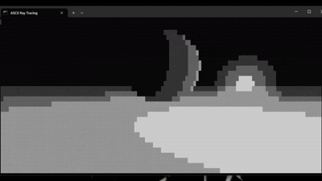

# ASCII Ray Tracing — Java

## Sobre o projeto

Este projeto implementa uma pequena demonstração de **Ray Tracing (rastreamento de raios)** utilizando Java, com toda a renderização realizada diretamente no terminal.

A cena apresenta uma esfera em movimento, uma fonte de luz e um plano que recebe sombras. Enquanto a esfera quica sob o efeito da gravidade, a câmera gira ao redor da cena, proporcionando uma visualização tridimensional animada.

A imagem é construída utilizando caracteres Unicode de diferentes intensidades, simulando sombreamento e iluminação sem a necessidade de uma interface gráfica.

O código foi organizado seguindo os princípios da **Programação Orientada a Objetos (POO)**: cada elemento da cena (luz, esfera, plano e câmera) é representado por uma classe com seus próprios dados e comportamentos. A cena, a renderização e a saída no terminal também possuem classes próprias.

## Demonstração

- Renderização tridimensional diretamente no terminal.
- Esfera com movimento e colisão com o plano.
- Simulação de gravidade.
- Iluminação e sombreamento.
- Efeito de luz (*Bloom*).
- Câmera com rotação ao redor da cena.
- Renderização utilizando diferentes níveis de intensidade dos caracteres.

## Tecnologias utilizadas

- **Java 16+:** linguagem utilizada no desenvolvimento.
- **Programação Orientada a Objetos:** classes, encapsulamento, imutabilidade, interfaces, classes abstratas, herança, polimorfismo, composição e enumerações.
- **Java Math:** operações matemáticas e cálculos geométricos.
- **Ray Tracing:** técnica utilizada para calcular interseções e iluminação.
- **Terminal UTF-8:** exibição dos caracteres utilizados na renderização.
- **ANSI Escape Codes:** atualização da imagem diretamente no terminal.

## Estrutura do projeto

```
rayrtracing-poo/
│
├── raytrace/
│   ├── main.java        # Ponto de entrada: monta a cena e controla o loop de animação
│   ├── vec3.java        # Vetor 3D imutável e suas operações matemáticas
│   ├── ray.java         # Raio imutável (origem e direção)
│   ├── Hit.java         # Resultado imutável de uma interseção
│   ├── Surface.java     # Interface: contrato de tudo que aparece na cena
│   ├── SceneObject.java # Classe abstrata: comportamento padrão das superfícies
│   ├── Sphere.java      # Esfera com gravidade e quique
│   ├── Plane.java       # Chão que recebe sombras
│   ├── Light.java       # Fonte de luz e efeito de brilho (bloom)
│   ├── Camera.java      # Câmera que gira ao redor da cena
│   ├── Scene.java       # Reúne câmera, luz e superfícies
│   ├── Renderer.java    # Calcula o brilho de cada pixel e monta o quadro
│   ├── Shade.java       # Enumeração dos caracteres de intensidade
│   ├── Terminal.java    # Saída no terminal (UTF-8 e ANSI)
│   └── FloatMath.java   # Função utilitária clamp
│
├── README.md
└── make.bat             # Script de compilação e execução (opcional)
```

### Papel de cada classe

| Classe / Interface | Papel                                                                                                              |
|--------------------|--------------------------------------------------------------------------------------------------------------------|
| `vec3`             | Vetor tridimensional imutável com as operações matemáticas.                                                        |
| `ray`              | Raio imutável: origem e direção.                                                                                   |
| `Hit`              | Resultado imutável de uma interseção: superfície atingida, ponto, normal e distância.                              |
| `Surface`          | Interface: toda superfície calcula a interseção com um raio, o próprio brilho e a sombra que projeta.              |
| `SceneObject`      | Classe abstrata que implementa `Surface` com o comportamento padrão (sem sombra, sem animação, não é fundo).       |
| `Sphere`           | Estende `SceneObject`. Guarda centro, velocidade e raio, simula gravidade e quique e projeta sombra.               |
| `Plane`            | Estende `SceneObject`. É o chão: calcula o próprio brilho considerando as sombras da cena.                         |
| `Light`            | Estende `SceneObject`. Fonte de luz visível; sabe a direção até ela e calcula o brilho ao redor (`bloom`).         |
| `Camera`           | Guarda posição e direção do olhar, monta o raio de cada pixel (`viewRay`) e gira a cada atualização (`update`).    |
| `Scene`            | Composição de câmera, luz e lista de `Surface`. Encontra a interseção mais próxima e atualiza todos os objetos.    |
| `Renderer`         | Calcula o brilho de cada pixel e monta o quadro de caracteres.                                                     |
| `Shade`            | Enumeração dos caracteres de intensidade; converte brilho (0 a 9) em caractere.                                    |
| `Terminal`         | Escreve no terminal em UTF-8 e controla a tela com códigos ANSI.                                                   |
| `FloatMath`        | Classe utilitária com a função `clamp`.                                                                            |
| `Main`             | Em `main.java`: monta a cena e executa o loop de animação.                                                         |

## Requisitos

Antes de executar o projeto, certifique-se de possuir:

- [Java JDK 16 ou superior](https://www.oracle.com/java/technologies/downloads/).
- Windows Terminal ou PowerShell.
- Terminal com suporte a UTF-8 e sequências ANSI.
- Janela de terminal com pelo menos **120 colunas por 30 linhas**.

Para verificar a instalação do Java, execute:

```
java -version
javac -version
```

## Como executar

### 1. Clone o repositório

```
git clone https://github.com/cauakssz/rayrtracing-poo.git
```

### 2. Entre na pasta do projeto

```
cd rayrtracing-poo
```

### 3. Compile os arquivos

```
javac -encoding UTF-8 -d . raytrace\*.java
```

O compilador encontra e compila automaticamente as demais classes do pacote `raytrace` a partir de `main.java`. Se nenhum erro for apresentado, a compilação foi concluída com sucesso.

Se você compilou uma versão anterior do projeto, apague os arquivos `.class` antigos da pasta `raytrace` antes de compilar.

### 4. Configure a codificação do terminal

No PowerShell, execute:

```
[Console]::OutputEncoding = [System.Text.Encoding]::UTF8
```

### 5. Execute o programa

```
java -cp . raytrace.Main
```

**Importante:** execute os comandos a partir da pasta raiz do projeto, e não de dentro da pasta `raytrace`.

## Execução simplificada no Windows

Também é possível utilizar o arquivo `make.bat`, caso esteja presente na raiz do projeto.

Basta dar dois cliques no arquivo para iniciar o processo de compilação e execução.

## Detalhes da implementação

### Renderização

A imagem é construída por meio de uma matriz de caracteres, na qual cada caractere representa um determinado nível de intensidade luminosa.

São utilizados caracteres Unicode de sombreamento:

| Caractere | Intensidade            |
|-----------|------------------------|
| Espaço    | Ausência de iluminação |
| ░         | Baixa                  |
| ▒         | Média                  |
| ▓         | Alta                   |
| █         | Máxima                 |

O brilho calculado para cada pixel (de 0 a 9) é convertido em caractere pela enumeração `Shade`, que agrupa dois níveis de brilho por caractere.

### Iluminação e sombras

O projeto calcula a interação dos raios com os elementos da cena, considerando:

- Interseção entre raios e esfera.
- Interseção entre raios e plano.
- Iluminação direta.
- Sombras projetadas pela esfera.
- Efeito de brilho (*Bloom*) próximo à fonte de luz.

### Animação

A movimentação da cena é realizada por atualizações sucessivas de posição e velocidade. A esfera sofre a influência da gravidade e inverte sua velocidade vertical ao atingir o plano. Simultaneamente, a câmera realiza uma rotação em torno da cena.



## Objetivo acadêmico

Este projeto tem como objetivo explorar conceitos de computação gráfica e programação orientada a objetos utilizando Java.

Durante sua implementação, são trabalhados conceitos como:

- Classes, objetos, atributos e métodos.
- Encapsulamento e imutabilidade.
- Interfaces, classes abstratas e herança.
- Polimorfismo e sobrescrita de métodos.
- Enumerações e classes utilitárias.
- Responsabilidade única e composição.
- Vetores e operações matemáticas tridimensionais.
- Geometria analítica.
- Rastreamento de raios.
- Interseções geométricas.
- Iluminação e sombreamento.
- Simulação física básica.
- Animação e renderização no terminal.

